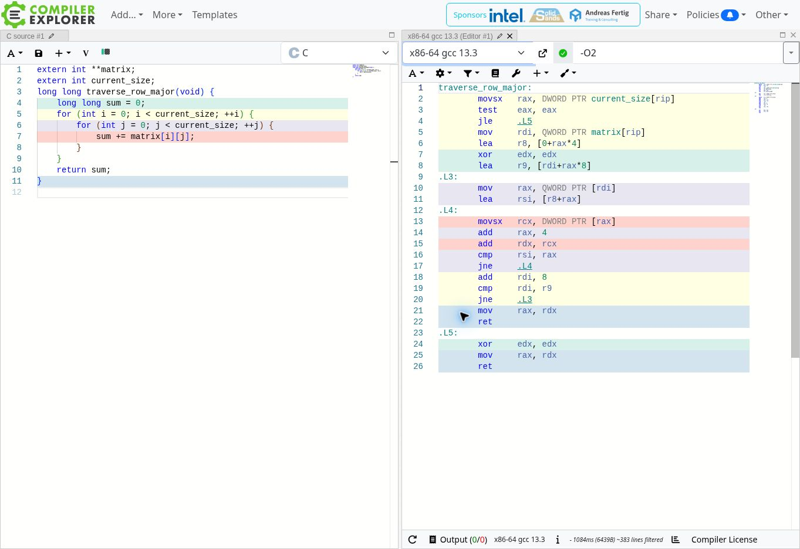
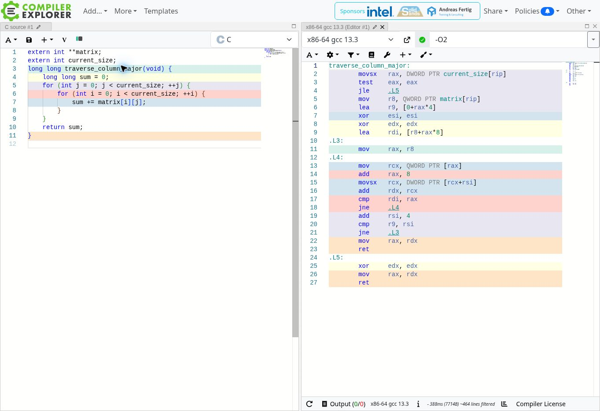

# Assignment 8: Cache Behavior Lab
Jesse Leyva

## Section 1: Performance Measurements

### Environment and method
Measured in a Linux x86-64 virtual machine on an Intel Xeon Platinum 8573C, using Ubuntu GCC 13.3.0. These are actual runs in this environment, not measurements from my personal laptop. See [environment details](evidence/environment.txt). The reported cache capacities are virtual-machine topology information, not guaranteed dedicated cache allocations.

The starter's `clock()` instrumentation measures process CPU time, converted to milliseconds. Allocation, initialization, printing, and freeing occur outside traversal timing. I ran three separate program executions per optimization level, retaining every raw output in `evidence/`. Tables use the median row time and median column time across those three executions. Ratios divide those two medians, rather than averaging the rounded ratios printed in the logs. The compiler consumes the sums through output and equality checks, so the work is observable.

No optimization flag (GCC's default, equivalent to `-O0`):

| Matrix size | Row-major (ms) | Column-major (ms) | Column / row |
|---|---:|---:|---:|
| 1000 × 1000 | 2.5420 | 3.1520 | 1.24× |
| 2000 × 2000 | 9.6610 | 14.3120 | 1.48× |
| 4000 × 4000 | 34.7240 | 74.4200 | 2.14× |
| 8000 × 8000 | 143.6420 | 408.9290 | 2.85× |

The four matrices contain approximately 3.81, 15.26, 61.04, and 244.14 MiB of integer data, excluding row pointers and allocation metadata. Matching sums are 49,500,000; 198,000,000; 792,000,000; and 3,168,000,000. The last sum exceeds a signed 32-bit integer, which is why the accumulator is `long long`.

### Reliability and memory checks
Both functions match an independently computed expected sum for the four required sizes and additional 1, 2, 3, and 17 cases. [tests.c](tests.c) also covers empty traversal, invalid sizes, repeated allocation/free, replacing an existing matrix, and failure of each allocation in an eight-row matrix. Allocation tracking returns to zero in every case. AddressSanitizer and UndefinedBehaviorSanitizer pass with `ASAN_OPTIONS=detect_leaks=0` ([test output](evidence/memory_checks.txt)). LeakSanitizer could not run because this environment blocks its process inspection, so this is not a claimed LeakSanitizer pass. The explicit allocation-failure tests cover the original starter's partial-allocation leak.

Limitations: row-major always runs first, following the starter, and there is no cache flush or randomized ordering. Initialization touches the matrix before timing. Small runs are sensitive to timer granularity, while shared VM resources cause variation, especially for large column traversals. These are illustrative warm-state measurements, not controlled cold-cache benchmarks. No hardware cache-miss counters were collected, so the bottleneck interpretation is supported by access patterns and assembly rather than directly measured miss counts.

## Section 2: Optimization Level Comparison

| Optimization | Matrix size | Row-major (ms) | Column-major (ms) | Column / row |
|---|---|---:|---:|---:|
| -O0 | 1000 × 1000 | 2.5420 | 3.1520 | 1.24× |
| -O0 | 2000 × 2000 | 9.6610 | 14.3120 | 1.48× |
| -O0 | 4000 × 4000 | 34.7240 | 74.4200 | 2.14× |
| -O0 | 8000 × 8000 | 143.6420 | 408.9290 | 2.85× |
| -O2 | 1000 × 1000 | 0.6700 | 0.9220 | 1.38× |
| -O2 | 2000 × 2000 | 1.8840 | 6.4710 | 3.43× |
| -O2 | 4000 × 4000 | 7.9730 | 91.5130 | 11.48× |
| -O2 | 8000 × 8000 | 34.9150 | 505.4840 | 14.48× |
| -O3 | 1000 × 1000 | 0.4500 | 1.2800 | 2.84× |
| -O3 | 2000 × 2000 | 1.5240 | 7.1730 | 4.71× |
| -O3 | 4000 × 4000 | 7.5290 | 101.4410 | 13.47× |
| -O3 | 8000 × 8000 | 28.8700 | 515.9360 | 17.87× |

`-O3` does not eliminate the performance gap: at 8000 × 8000, column traversal remains about 17.87 times slower. Higher optimization reduces loop overhead and vectorizes the row traversal, but the column traversal retains scattered accesses. Consequently, faster instruction execution cannot remove the cost of an unfavorable memory access pattern.

## Section 3: Assembly Analysis

### Compiler Explorer screenshots
Both screenshots are from [Compiler Explorer](https://godbolt.org/), set to **C, x86-64 GCC 13.3, `-O2`**, with each function pasted separately and its globals declared `extern`. They show actual compiler output, not reconstructed illustrations. Local assembly is also included in [cache_O2.s](evidence/cache_O2.s), generated with `gcc -O2 -fno-inline -S -masm=intel cache_lab.c -o evidence/cache_O2.s`. `-fno-inline` keeps function boundaries explicit in the local assembly artifact; benchmark binaries use only their stated optimization flags.

**Row-major:**



**Column-major:**



The functions have similar scalar arithmetic and loop-control structure, but their loads are meaningfully different. Row-major loads a row pointer once per outer iteration, then its inner loop executes `movsx rcx, DWORD PTR [rax]`, `add rax, 4`, `add rdx, rcx`, `cmp`, and `jne`. Column-major loads a new row pointer with `mov rcx, QWORD PTR [rax]`, advances that pointer-table address by eight bytes, and then loads the element with `movsx rcx, DWORD PTR [rcx+rsi]`. The dependent pointer load repeats for every element in column order.

There is no expensive multiplication or function call in either inner loop at O2. Similar instruction types can run at very different speeds because a load's latency depends on where its data resides. Locality, prefetching, dependent loads, and address translation provide the main hardware explanation for the large measured gap. The extra column pointer load is a real code-generation difference, so the assembly is similar rather than identical. At O3, [cache_O3.s](evidence/cache_O3.s) shows `movdqu` and `paddq` in the row traversal: SIMD makes that loop more efficient without converting the column loop to sequential traversal.

### Instruction categories

| Instruction example | Category | Role |
|---|---|---|
| `mov rcx, QWORD PTR [rax]` | Memory/data transfer | Load a row pointer |
| `movsx rcx, DWORD PTR [rax]` | Memory load and conversion | Load an int and sign-extend it to 64 bits |
| `mov rax, rdx` | Register data transfer | Place the result in the return register |
| `lea rsi, [r8+rax]` | Address arithmetic | Compute an address without reading memory |
| `add rdx, rcx` | Integer arithmetic | Accumulate the sum |
| `add rax, 4` | Address arithmetic | Advance one four-byte int |
| `xor edx, edx` | Logical/register initialization | Clear the accumulator |
| `cmp`, `test` | Comparison/flags | Set condition flags |
| `jne`, `jle` | Conditional control flow | Continue or exit loops |
| `ret` | Control flow | Return to the caller |
| `movdqu`, `paddq` at O3 | SIMD data transfer/arithmetic | Load multiple integers and add packed 64-bit sums |

### RISC and CISC design tradeoffs

x86-64 is a CISC instruction set with variable-length instruction encodings and rich addressing modes. A64 is a RISC instruction set with fixed 32-bit instructions and a load/store design: arithmetic primarily operates on registers, with separate memory instructions. Fixed encodings simplify decoding, while expressive CISC encodings can improve code density or reduce the number of visible instructions for some tasks. More instructions does not automatically mean more cycles, and RISC does not mean every instruction takes one cycle. Modern implementations of both families can use pipelining, out-of-order execution, SIMD, and caches; modern x86 cores translate instructions into internal operations. Changing instruction-set families would not automatically fix this program's locality problem. This lab benchmarks only x86-64, so it does not establish which architecture is faster.

## Section 4: Cache Behavior Explanation

C stores a true two-dimensional array in row-major order: adjacent columns within a row occupy adjacent memory addresses. For an array declared as int a[N][N], the address of a[i][j] is the base address plus (i*N+j)*sizeof(int). This starter uses int** instead, with one allocation for row pointers and a separate allocation for each row. Each individual row is contiguous, but consecutive rows are not guaranteed to be adjacent. That distinction matters because column traversal follows pointers between allocations rather than stepping through one guaranteed contiguous matrix. Both functions still visit N squared elements and perform the same integer reduction.

The CPU transfers data through its cache hierarchy in cache lines. With a 64-byte line and four-byte integers, an aligned line holds sixteen adjacent values. Row-major traversal uses those neighboring values immediately, so one fetched line supports many consecutive additions. Its regular addresses also help hardware prefetchers bring upcoming lines closer to the processor before they are needed. Column-major traversal consumes one integer from a row and then jumps to another row. It returns to neighboring integers only after visiting every other row. Those delays increase the working set of active lines and pages, creating opportunities for cache eviction and translation lookaside buffer misses. Some lines can remain in a larger cache, so it would be incorrect to claim every column access reaches main memory. Nevertheless, the access pattern makes efficient use of the fastest caches harder.

Compiler optimization reduces instruction overhead but does not automatically change this layout. The O2 assembly retains different address sequences, and O3 vectorizes the row loop while leaving column accesses scattered. Compilers can interchange loops when legality and profitability are established; GCC even provides loop interchange at O3. However, a general pointer-based loop does not establish a fixed contiguous matrix layout, and dependency, aliasing, and reduction analysis can limit transformations. Therefore, optimization flags do not guarantee repair of this source pattern. For these initialized, bounded integer sums, manually swapping the loops is safe and preserves the result. The remaining performance gap points to data locality and memory-system behavior as the principal explanation, rather than fundamentally different arithmetic algorithms.

### Connection to my final project

*Proposed application to a warehouse scenario; the final-project topic has not been confirmed.*

For a final project based on warehouse routing optimization, I would store location-to-location distances in a flat array indexed as `distances[from * location_count + to]`. When evaluating the next destination from one location, I would keep `from` fixed and scan candidate `to` values consecutively to reuse adjacent cache lines. If an operation needs both orientations, I would compare a transposed copy or blocked traversal with the baseline while accounting for extra memory and preprocessing time. I would verify identical routing scores and measure representative input sizes before claiming a speed improvement.

## Reproduction

```bash
gcc -std=c11 -Wall -Wextra -Wpedantic cache_lab.c -o cache_lab
./cache_lab
python3 benchmark.py
gcc -O1 -g -fsanitize=address,undefined -fno-omit-frame-pointer tests.c -o cache_tests
ASAN_OPTIONS=detect_leaks=0 ./cache_tests
```

`benchmark.py` refreshes raw logs and the measurements CSV. Recompute this document's tables if running it on another machine. Performance runs exclude sanitizer instrumentation. No benchmark executable is committed.

## References

- GCC 13.3 optimization options, including loop interchange and vectorization: https://gcc.gnu.org/onlinedocs/gcc-13.3.0/gcc/Optimize-Options.html
- Intel, “Loop Optimizations Where Blocks are Required,” cache lines, spatial locality, and blocking: https://www.intel.com/content/www/us/en/developer/articles/technical/loop-optimizations-where-blocks-are-required.html
- Arm Instruction Set Reference Guide, A1.1–A1.2, load/store architecture and A64 instruction width: https://documentation-service.arm.com/static/6245c734b059dc5ff9a8bdab
